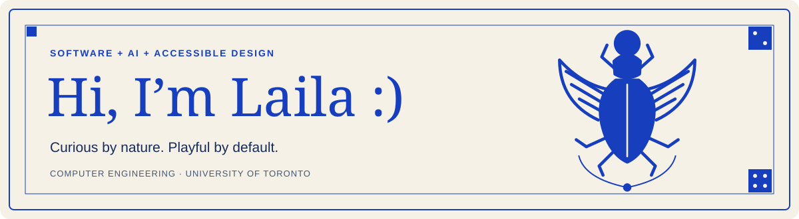

Computer Engineering student at the University of Toronto.

I like figuring out how things work—and how to make them work better for people. Usually that means building software, experimenting with AI, or asking whether an interface really needs that many buttons.

I care about accessible design and making everyday things a little easier to use.

 

## A few things about me

- 🛠️ I like building things people can actually use.
- 💬 I start with people: what’s frustrating, what’s missing, and what would help.
- ♿ Accessibility belongs in the first draft.

## Things I’ve been building

### [ClearRoute · Accessible navigation](https://github.com/lailaassy/ClearRoute)
Co-led a team of three building a navigation map for people with low vision, with high-contrast themes, text-to-speech directions, fuzzy search, and multi-stop route planning.

**C++ · OpenStreetMap · OpenMP**

### Hawkins: The Last Signal · In progress
A story-based capture-the-flag game I’m building for beginners in our cybersecurity club. Players learn through six guided challenges, with private bot conversations, saved progress, scoring, and optional hints that cost points.

**Python · SQLite · Mattermost · Docker**

The playable prototype is built; event testing and finishing the player experience are next.

### [Flappy Bird on FPGA](https://github.com/lailaassy/Flappy-Bird-Digital-Systems)
A digital systems course project built with Margaret Boychuk and Manahil Saeed. We recreated Flappy Bird in hardware, with VGA output, movement, collision detection, and score tracking.

**Verilog · Quartus · ModelSim**

## My toolbox

**Languages:** Python · C/C++ · TypeScript · JavaScript · SQL

**Software & design:** React · Flask · Node.js · REST APIs · Git · Figma

### Tools I’ve used at work

| Area | Tools & skills |
| :--- | :--- |
| AI & agents | LangGraph · LangChain · Langfuse · MCP servers · RAG |
| Cloud & infrastructure | Docker · Kubernetes · OpenShift · Azure |
| Messaging & integrations | Kafka · Webhooks |
| Monitoring & networking | Grafana · Infoblox · ExtraHop · Telemetry analysis |
| Testing & delivery | GitHub Actions · CI/CD · SonarQube · Smoke testing |

---

[Let’s connect on LinkedIn](https://www.linkedin.com/in/laila-assy/) · [laila.assy@outlook.com](mailto:laila.assy@outlook.com)
